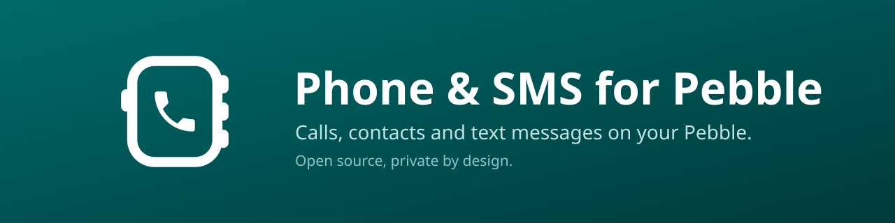
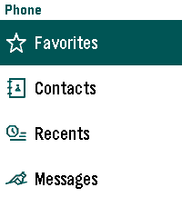
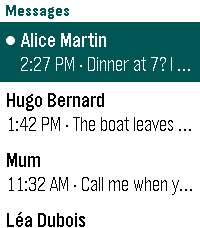
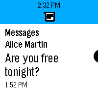
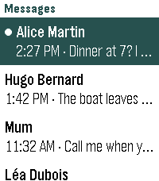
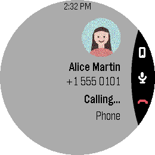
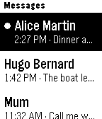

[](https://github.com/loxK/pebble-phone-sms/releases/latest)
[](https://github.com/loxK/pebble-phone-sms/releases/latest/download/pebble-phone-sms.pbw)
[](https://github.com/loxK/pebble-phone-sms-android)
[](https://github.com/loxK/pebble-phone-sms/actions/workflows/build.yml)
[](LICENSE)

# Phone & SMS for Pebble

Calls, contacts and text messages on your Pebble watch. Private by design: its Android companion has no internet access.

Phone & SMS brings favorites, contacts, the call log, call control and SMS and RCS conversations to the watch, with voice replies. It requires its Android companion, [Pebble Phone Connect](https://github.com/loxK/pebble-phone-sms-android).

## Get it

[](https://github.com/loxK/pebble-phone-sms/releases/latest)

- ⬇️ Download the latest **[`pebble-phone-sms.pbw`](https://github.com/loxK/pebble-phone-sms/releases/latest/download/pebble-phone-sms.pbw)** and install it with the Pebble app.
- 📱 Install **[Pebble Phone Connect](https://github.com/loxK/pebble-phone-sms-android)** on the phone and complete its setup.
- 📝 What changed in each version: [`CHANGELOG.md`](CHANGELOG.md).

## Features

- ⭐ **Favorites** displayed as cards with contact photos
- 📇 **Contact directory** browsed by initial, with voice search by name or nickname
- 🕘 **Call history** with missed, incoming, outgoing and declined calls
- 🔢 **Dial pad** operable by buttons or touch
- 📞 **Call screen** matching the system design: caller photo, duration, mute, audio output (earpiece, speaker, Bluetooth) and hang-up, reachable directly through quick launch during a call
- 💬 **SMS and RCS conversations** with unread markers, full message text and pictures
- 🗣️ **Replies** by voice dictation, emoji or predefined quick replies
- 📱 **Handoff to the phone**: any conversation can be opened in the messaging app
- 🔔 **Launcher glance** showing the latest missed call or message and its age, configurable in the companion settings
- 🔤 **Adjustable text size**, following the watch setting or set from the phone
- 👆 **Touch support** on compatible watches, and native layouts on round displays
- 🌍 **Localized** in English and French

## Requirements

- A Pebble Time, Time Steel, Time Round, Pebble 2, Pebble 2 Duo, Time 2 or Round 2. The original Pebble and Pebble Steel are not supported: their 24 KB of application memory is not enough for this app.
- An Android phone with [Pebble Phone Connect](https://github.com/loxK/pebble-phone-sms-android) and the [Pebble app](https://github.com/coredevices/mobileapp).
- iOS is not supported: it does not allow third-party apps to read the call log or text messages.

## Limitations

- What the watch shows depends on what the phone can read and send: the [limitations of Pebble Phone Connect](https://github.com/loxK/pebble-phone-sms-android#limitations) apply, RCS replies and group conversations among them.
- Calls are controlled from the watchapp, which has to be open during the call.
- The launcher glance is updated when the app closes and expires after 24 hours: a call or text received since then appears after the next use of the app.

> [!TIP]
> Assign Phone & SMS to a quick launch button on the watch (Settings › Quick Launch, for example a long press on Down). It then opens directly on the call in progress.

## Screenshots

<div align="center">

&nbsp;&nbsp;

&nbsp;&nbsp;


<sub>Favorites, messages and replies on a Pebble Time 2.</sub>

<br><br>


&nbsp;&nbsp;

&nbsp;&nbsp;


<sub>Conversations on a Pebble Time 2, a call on a Pebble Round 2, conversations on a Pebble 2 Duo.</sub>
</div>

## Download & verify

Every [release](https://github.com/loxK/pebble-phone-sms/releases/latest) ships `pebble-phone-sms.pbw` with its **SHA-256** (`pebble-phone-sms.pbw.sha256`) and a build provenance attestation signed by GitHub, which ties the file to the workflow run and the commit that produced it. The Pebble App Store distributes the same file, byte for byte, so both commands also verify a copy downloaded from the store.

```sh
sha256sum -c pebble-phone-sms.pbw.sha256        # -> pebble-phone-sms.pbw: OK
gh attestation verify pebble-phone-sms.pbw --repo loxK/pebble-phone-sms
```

## Build from source

With the [Pebble SDK](https://developer.repebble.com/sdk/):

```sh
pebble build
pebble install --emulator emery      # try it in the emulator
pebble install --phone <ip>          # install to your watch
```

The build produces `build/pebble-phone-sms.pbw`. `package.json` declares the two companion packages allowed to exchange messages with the watchapp: `nc.gecka.pebblephone` and its debug build, `nc.gecka.pebblephone.debug`. The messages they exchange are described in the [protocol](https://github.com/loxK/pebble-phone-sms-android/blob/main/PROTOCOL.md) of the companion, which keeps its keys in step with this `package.json`.

### Generated files

The scripts in `tools/` run with [uv](https://docs.astral.sh/uv/) and need `rsvg-convert` and ImageMagick. Their output is committed, so a plain build needs none of them.

- `uv run tools/make_icons.py` turns the SVG icons of `assets/icons/` into the PDC images of `resources/pdc/`, `launcher.svg` into the launcher icon, `resources/images/menu_icon.png`, and the glance icons into 25 px PNGs: SDK 4.33.1 fails on a PDC image published for a glance.
- `uv run tools/make_demo_photos.py` encodes the made-up portraits of `assets/demo/` for the demo build.

### Store screenshots

`tools/shoot_screenshots.sh` captures the store screenshots of every platform into `assets/screenshots/`: three animated GIFs and two stills each. It builds the watchapp in demo mode, with made-up contacts and messages at a fixed date, so every run shows the same content, and cleans that build on the way out. It requires ffmpeg, uv and exclusive use of the emulators.

The SDK emulators run firmware 4.33, older than the colour emoji of 4.39. For Time 2 and Round 2, point `PEBBLEOS` to a [PebbleOS](https://github.com/coredevices/PebbleOS) checkout holding QEMU builds, made in the PebbleOS CI image:

```sh
pbl -b build-qemu-emery configure --board qemu_emery
pbl -b build-qemu-emery build qemu_image_micro qemu_image_spi
```

Those platforms then run that firmware in Docker, from the image of `tools/qemu.Dockerfile`:

```sh
PEBBLEOS=~/src/PebbleOS tools/shoot_screenshots.sh
```

## Releases

Pushing a tag `vX.Y.Z` builds the watchapp, attests its provenance and publishes a GitHub release with the `.pbw`, its checksum and the matching section of [`CHANGELOG.md`](CHANGELOG.md). The tag has to match the version in `package.json`. That `.pbw` is the one published on the Pebble App Store.

## License

Copyright © 2026 Laurent Dinclaux

Released under the **GNU Affero General Public License v3.0 or later** (AGPL-3.0-or-later). See [`LICENSE`](LICENSE).

These come from [PebbleOS](https://github.com/coredevices/PebbleOS) and are distributed under the Apache License 2.0, whose text is in [`resources/LICENSE.Apache-2.0`](resources/LICENSE.Apache-2.0):

- the "Sent" animation and the warning and SMS icons in `resources/pdc/`, and the down arrow in `resources/images/`
- the icons of `assets/icons/` and their PDC images, from the PebbleOS resources and its [iconography](https://github.com/pebble-dev/iconography), `outgoing.svg` and `phone.svg` being cut from its call icons. `favorites.svg` and `launcher.svg` are drawn for this app and fall under its own license
- the SMS glance icon, `assets/glance/sms.svg`, from the same iconography

The handset of the app icon (`assets/icon.svg` and `assets/icons/launcher.svg`) is the "call" icon of [Material Icons](https://github.com/google/material-design-icons), Apache License 2.0.

---

Built with 🥥 and ☕ by Lox — Kanaky-New Caledonia 🇳🇨
